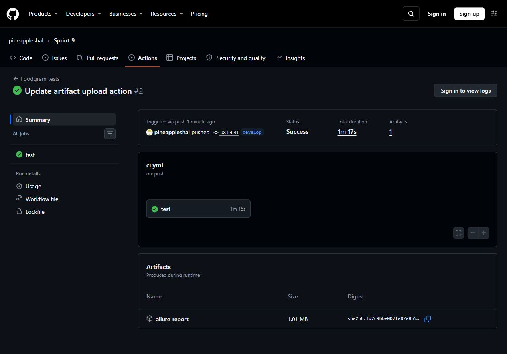

# Sprint_9

Автотесты сервиса «Продуктовый помощник».

Кузина Валерия, поток 37.

## Сценарии

1. Регистрация: переход на `/signin` и отображение формы авторизации.
2. Авторизация: переход на `/recipes` и отображение кнопки «Выход».
3. Создание рецепта: выбор ингредиента из выпадающего списка, заполнение формы, загрузка изображения и проверка названия в карточке созданного рецепта.

Тесты независимы: для каждого создаются уникальные данные и отдельная сессия браузера. Пользователи для предусловий создаются через API; проверяемые действия выполняются через UI. После теста удаляются рецепты тестового пользователя и отзывается его токен. Удаление пользователей на этом стенде не поддерживается: `DELETE /api/users/me/` и `DELETE /api/users/{id}/` возвращают 405.

## Структура

- `test/` — три тестовых модуля с отдельными классами по функциональности.
- `pages/` — Page Object для страниц и общий компонент шапки.
- `locators/` — локаторы элементов.
- `helpers/` — запуск браузера и API для подготовки/очистки данных.
- `data.py`, `config.py`, `conftest.py` — данные, настройки и фикстуры.
- `assets/recipe.png` — изображение для загрузки, путь строится через `pathlib.Path`.
- `Dockerfile`, `docker-compose.yml`, `selenoid/browsers.json` — запуск в контейнерах.
- `.github/workflows/ci.yml` — пайплайн GitHub Actions.
- `allure-report/` — готовый отчёт. Исходные `allure-results/` исключены из Git.

## Запуск в локальном Chrome

Нужны Python 3.12+ и установленный Google Chrome.

```powershell
python -m venv .venv
.\.venv\Scripts\python.exe -m pip install -r requirements.txt
.\.venv\Scripts\python.exe -m pytest
```

Для запуска с видимым окном добавь `--headed`. При первом локальном запуске Selenium Manager подберёт ChromeDriver. Selenium взаимодействует с браузером только через Page Object; используются явные ожидания.

## Docker и Selenoid

Нужен Docker с Linux-контейнерами и Docker Compose v2. Команды выполняются из корня проекта:

```sh
docker pull selenoid/chrome:128.0
docker compose up -d selenoid
curl --fail --retry 20 --retry-all-errors --retry-delay 1 http://localhost:4444/status
docker compose up --build --exit-code-from tests tests
docker compose down
```

В Windows PowerShell для проверки готовности используй `curl.exe` вместо `curl`. Selenoid доступен только по адресу `127.0.0.1:4444`; контейнер с тестами подключается к нему по внутренней сети. Для загрузки изображения в удалённый браузер используется `LocalFileDetector`.

Настройки можно изменить через переменные окружения `BASE_URL`, `API_URL`, `SELENOID_URL`, `BROWSER_VERSION`. Значения по умолчанию соответствуют первому стенду из задания и Chrome 128.0 из подсказки. Фронтенд и API должны относиться к одному стенду.

## Allure

После запуска тестов, при установленном Node.js 22+:

```sh
npx --yes allure@3.33.0 generate allure-results --output allure-report
```

Открой `allure-report/index.html` в браузере: отчёт собран в один HTML-файл. Пайплайн сохраняет отчёт и исходные результаты как артефакт `allure-report`, включая неуспешные запуски.

## CI/CD

Пайплайн запускается при изменении кода в `main`/`develop`, создании pull request в `main` и вручную через GitHub Actions. Он скачивает браузер, поднимает Selenoid, собирает образ тестов, выполняет pytest, формирует отчёт и останавливает контейнеры. Ошибка pytest сохраняется как ошибка пайплайна.

## Проверка

- Локальный Chrome: **3 passed**.
- Chrome 128.0 через Docker и Selenoid: **3 passed**, все фикстуры завершились успешно.
- [Успешный запуск GitHub Actions](https://github.com/pineappleshal/Sprint_9/actions/runs/45361077256).
- Отчёт в `allure-report/` и скриншот ниже относятся к этому запуску.



## Особенность учебного стенда

Поле входа подписано «Электронная почта», однако API первого стенда фактически проверяет `username`: с различными значениями `email` и `username` вход по email возвращает 400, а по username проходит. В данных обязательных положительных сценариев `username` равен `email`; это допустимые уникальные значения обоих полей. Тесты проверяют все действия и результаты из задания, но отдельно не покрывают вход, когда имя пользователя отличается от почты.
